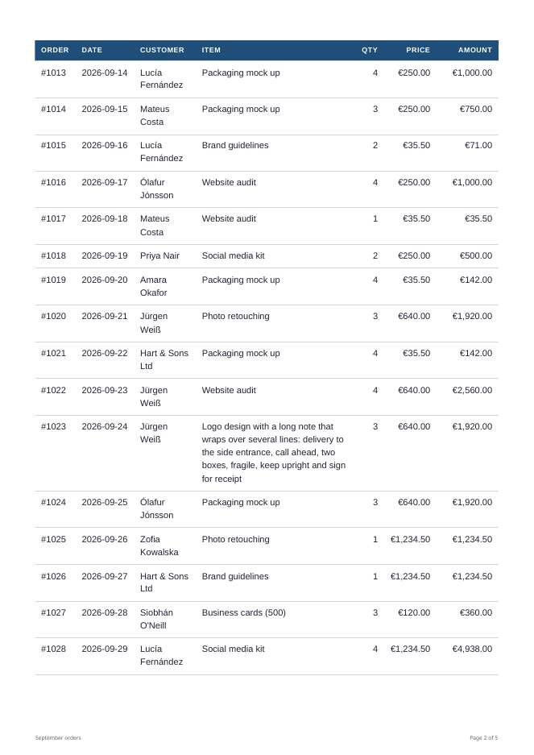
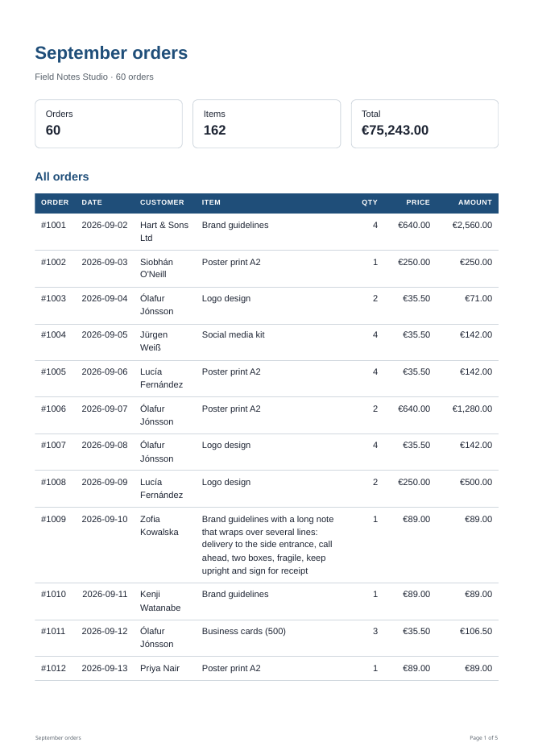

(Disclosure: I'm connected to thirds.ai.)
Drafted with AI help.

# HTML templates to PDF in Activepieces with the HTTP step

Activepieces has no built in "HTML to PDF" step, but its HTTP step can call any HTML to PDF API. This tutorial builds a small flow that turns a list of rows into a multi page A4 report, and covers the three things that usually go wrong when HTML is printed: table headers that vanish after page 1, rows and sections that break in the wrong place, and margins that do not match. The example API is [thirds.ai's HTML to PDF API](https://thirds.ai/html-to-pdf?utm_source=github&utm_medium=community&utm_campaign=own-content&utm_content=activepieces-html-to-pdf-tutorial); the CSS works the same with any Chromium based renderer.

The finished report is 5 A4 pages: 60 orders, a header row on every table page and a Notes page at the end.



## 1. Build the HTML in a Code step

Add a **Code** step and paste the code below. Map its inputs: `title`, `company`, `currency`, `notes` and `rows`. `rows` is a list of `{ order, date, customer, item, qty, price }`, for example from Google Sheets "Get Rows" or a database step.

The step returns `body`, the whole request for the API, and `idempotency_key`. Building the HTML in code rather than pasting it into the HTTP step has two benefits. Every value is escaped, so a customer called `O'Neill <script>` prints as text. The JSON stays valid however long the HTML gets.

```javascript
// Activepieces Code step "Build report": turns a list of rows into print ready HTML for the HTTP step.
// Inputs: title, company, currency (3 letter code), notes, rows (a list or JSON text of
//   { order, date, customer, item, qty, price } objects, for example from Google Sheets "Get Rows").
// Output: body (the JSON body for POST /v1/pdf), idempotency_key, file_name.
export const code = async (inputs) => {
  const clean = (v) => String(v == null ? '' : v).trim();
  const esc = (v) => clean(v).replace(/[&<>"']/g, (c) => ({ '&': '&amp;', '<': '&lt;', '>': '&gt;', '"': '&quot;', "'": '&#39;' }[c]));
  const rows = typeof inputs.rows === 'string' ? JSON.parse(inputs.rows || '[]') : (inputs.rows || []);
  if (!Array.isArray(rows) || !rows.length) throw new Error('rows is empty: map a list of rows into this step');
  const cur = (clean(inputs.currency) || 'GBP').toUpperCase();
  const money = (n) => { try { return new Intl.NumberFormat('en-GB', { style: 'currency', currency: cur }).format(n); } catch (e) { return `${Number(n).toFixed(2)} ${cur}`; } };
  const lines = rows.map((r, i) => {
    const qty = Number(r.qty), price = Number(r.price);
    if (!(qty > 0) || !isFinite(price)) throw new Error(`row ${i + 1} (${clean(r.order)}): qty and price must be numbers`);
    return { ...r, qty, price, amount: Math.round(qty * price * 100) / 100 };
  });
  const total = Math.round(lines.reduce((s, r) => s + r.amount, 0) * 100) / 100;
  const title = clean(inputs.title) || 'Report';

  const html = `<!doctype html><html lang="en"><head><meta charset="utf-8"><title>${esc(title)}</title><style>
/* Page size and margins come from the request (pdf.format and pdf.margins), so they are not repeated here. */
* { box-sizing: border-box; }
body { margin: 0; font: 10pt/1.45 "Liberation Sans", Arial, sans-serif; color: #1d2433; -webkit-print-color-adjust: exact; print-color-adjust: exact; }
h1 { font-size: 20pt; margin: 0 0 2mm; color: #1f4e79; }
h2 { font-size: 13pt; margin: 8mm 0 3mm; color: #1f4e79; break-after: avoid; }
.muted { color: #57606a; }
.cards { display: flex; gap: 4mm; margin: 6mm 0; }
.card { flex: 1; border: 1px solid #d0d7de; border-radius: 2mm; padding: 3mm 4mm; break-inside: avoid; }
.card b { display: block; font-size: 15pt; }
table { width: 100%; border-collapse: collapse; }
thead { display: table-header-group; }   /* repeat the header row on every page */
tfoot { display: table-row-group; }      /* print the total once, at the end */
tr { break-inside: avoid; }              /* never split a row across two pages */
th { text-align: left; font-size: 8pt; letter-spacing: .06em; text-transform: uppercase; color: #fff; background: #1f4e79; padding: 2mm 2.5mm; }
td { padding: 2mm 2.5mm; border-bottom: 1px solid #d0d7de; vertical-align: top; overflow-wrap: anywhere; }
.r { text-align: right; white-space: nowrap; }
.total td { font-weight: 700; font-size: 11pt; background: #eef3f9; }
.new-page { break-before: page; }        /* start this section on a fresh page */
.keep { break-inside: avoid; }
</style></head><body>
<h1>${esc(title)}</h1>
<div class="muted">${esc(inputs.company)} &middot; ${lines.length} orders</div>
<div class="cards"><div class="card">Orders<b>${lines.length}</b></div><div class="card">Items<b>${lines.reduce((s, r) => s + r.qty, 0)}</b></div><div class="card">Total<b>${esc(money(total))}</b></div></div>
<h2>All orders</h2>
<table><thead><tr><th>Order</th><th>Date</th><th>Customer</th><th>Item</th><th class="r">Qty</th><th class="r">Price</th><th class="r">Amount</th></tr></thead>
<tbody>${lines.map((r) => `<tr><td>${esc(r.order)}</td><td class="r">${esc(r.date)}</td><td>${esc(r.customer)}</td><td>${esc(r.item)}</td><td class="r">${r.qty}</td><td class="r">${esc(money(r.price))}</td><td class="r">${esc(money(r.amount))}</td></tr>`).join('')}</tbody>
<tfoot><tr class="total"><td colspan="6">Total</td><td class="r">${esc(money(total))}</td></tr></tfoot></table>
<section class="new-page"><h2>Notes</h2><div class="keep"><p>${esc(inputs.notes)}</p></div></section>
</body></html>`;

  const hash = (s) => { let h = 2166136261; for (const ch of s) { h ^= ch.codePointAt(0); h = Math.imul(h, 16777619) >>> 0; } return h.toString(36); };
  const slug = title.toLowerCase().replace(/[^a-z0-9]+/g, '-').replace(/^-|-$/g, '') || 'report';
  return {
    file_name: `${slug}.pdf`,
    idempotency_key: `ap-report-${slug}-${hash(html)}`,
    body: {
      html,
      wait: true,
      pdf: {
        format: 'A4',
        margins: { top: '16mm', right: '14mm', bottom: '20mm', left: '14mm' },
        display_header_footer: true,
        header_template: '<span></span>',
        footer_template: `<div style="width:100%;font-size:8px;color:#57606a;padding:0 14mm;display:flex;justify-content:space-between"><span>${esc(title)}</span><span>Page <span class="pageNumber"></span> of <span class="totalPages"></span></span></div>`,
        title,
      },
    },
  };
};
```

## 2. Send it with the HTTP step

Add **HTTP, Send HTTP request** and set:

| Field | Value |
|---|---|
| Method | POST |
| URL | `https://thirds.ai/v1/pdf` |
| Headers | `Idempotency-Key` = `{{step_1['output']['idempotency_key']}}` |
| Authentication | Bearer Token, your API key |
| Body Type | JSON |
| JSON Body | `{{step_1['output']['body']}}` |
| Failure mode | Retry on internal errors (5xx) |

The same settings, in the shape of a step in an exported Activepieces flow, with `PASTE_YOUR_THIRDS_API_KEY` in place of the key:

```json
{
  "name": "step_2",
  "valid": false,
  "displayName": "Render PDF (thirds.ai)",
  "lastUpdatedDate": "2026-10-22T00:00:00.000Z",
  "type": "PIECE",
  "settings": {
    "pieceName": "@activepieces/piece-http",
    "pieceVersion": "~0.13.0",
    "actionName": "send_request",
    "input": {
      "method": "POST",
      "url": "https://thirds.ai/v1/pdf",
      "headers": {
        "Idempotency-Key": "{{step_1['output']['idempotency_key']}}"
      },
      "queryParams": {},
      "authType": "BEARER_TOKEN",
      "authFields": {
        "token": "PASTE_YOUR_THIRDS_API_KEY"
      },
      "body_type": "json",
      "body": {
        "data": "{{step_1['output']['body']}}"
      },
      "response_is_binary": false,
      "use_proxy": false,
      "timeout": 120,
      "followRedirects": false,
      "failureMode": "retry_5xx"
    },
    "propertySettings": {},
    "errorHandlingOptions": {
      "continueOnFailure": {
        "value": false
      },
      "retryOnFailure": {
        "value": false
      }
    }
  }
}
```

The token is stored in the flow, so remove it before you export or share the flow. The key is made from the HTML, so a retried run returns the same PDF instead of rendering it twice.

The body asks for `wait: true`, so the step answers when the PDF is ready:

```json
{ "id": "pdf_...", "status": "succeeded", "download": { "url": "/v1/downloads/..." } }
```

The download link is relative and signed. Put `https://thirds.ai` in front of `{{step_2['output']['body']['download']['url']}}` and pass the full link to the next step, for example as a Gmail attachment or a Google Drive "Upload file" step. Activepieces downloads a file given as a link. The link needs no key and lasts about 15 minutes, so use it straight away.

## 3. Table headers that repeat on every page

A long `<table>` runs over several pages. To print its column headings at the top of each page, put them in `<thead>` and keep the rows in `<tbody>`:

```css
thead { display: table-header-group; }   /* repeat the header row on every page */
tfoot { display: table-row-group; }      /* print the total once, at the end */
tr    { break-inside: avoid; }           /* never split a row across two pages */
```

`table-header-group` is the default for `thead`, so setting it again guards against a reset stylesheet or a `display: block` rule that would turn it off. Chromium also repeats `tfoot` on every page by default. `table-row-group` turns that off, so a total row appears once, under the last row. Leave out the `tfoot` rule if you want a running footer row instead.

In the sample PDF the header row is at the top of pages 1, 2, 3 and 4, and each of pages 2 to 4 starts with a whole order.



## 4. Page breaks

Three rules decide where pages break:

```css
.new-page { break-before: page; }   /* start a section on a fresh page */
tr, .card, .keep { break-inside: avoid; }   /* keep a row or a box in one piece */
h2 { break-after: avoid; }          /* keep a heading with what follows it */
```

* `break-before: page` on the Notes section puts it at the top of page 5, even though page 4 has room left.


* `break-inside: avoid` on `tr` moves a whole row to the next page when it does not fit. Four sample rows wrap over five lines, and each stays together.
* A block can only be kept together if it fits on one page. A taller block still breaks, so keep cards and totals short.
* Do not give rows a fixed height or `overflow: hidden`. Let them grow with their text, or long values get cut off.

## 5. Margins: set them once, in the request

Page size and margins belong in the request's `pdf` object:

```json
"pdf": { "format": "A4", "margins": { "top": "16mm", "right": "14mm", "bottom": "20mm", "left": "14mm" } }
```

* A side that is left out is `0mm`, and every value needs a unit (`mm`, `cm`, `in` or `px`).
* The request sets the paper size. A CSS `@page { size: ... }` rule does not change it, so keep the CSS and the request in agreement ([PDF and image options](https://thirds.ai/docs/pdf-and-image-options?utm_source=github&utm_medium=community&utm_campaign=own-content&utm_content=activepieces-html-to-pdf-tutorial)).
* A CSS `@page { margin: ... }` rule does win over `pdf.margins`. The same report with `@page { margin: 30mm }` added came out with its text about 32mm from the top and side edges instead of about 16mm, and grew from 5 pages to 7. Set margins in one place: either leave `@page` margins out of the template, as `build-report.js` does, or make them match.

The footer uses the bottom margin. `display_header_footer: true` with a `footer_template` prints "Page 3 of 5" on every page, using the `pageNumber` and `totalPages` classes. Give the template its own `font-size`, because it does not inherit the page's styles. Also set `header_template` to `<span></span>`. Without it, Chromium prints its default header with the date and title at the top of every page.

## Test it before you build the flow

Run the Code step's function once in Node on a few sample rows and save `body.html` to a file. Open that file in Chrome and use Print preview: the header row, the page breaks and the Notes page show up there without rendering a PDF. Then send `body` once to `POST /v1/pdf` with your key and check the result before you wire it into the flow.

What has been tested: the Code step and the HTTP step's request, run live against the real API. The result is a 5 page A4 PDF with the header row on pages 1 to 4, no split rows, Notes at the top of page 5 and the footer on every page. Inside Activepieces Cloud (HTTP piece v0.13.0, 24 Oct 2026), the Code step ran and the HTTP step resolved `{{step_1['output']['body']}}` into the JSON body and `{{step_1['output']['idempotency_key']}}` into the header. That run used a placeholder token and got the expected 401, so no PDF was made inside Activepieces. The older `{{step_1.body}}` form resolves to an empty value in the current builder, so use the form shown here or pick the field with the data selector.

The finished PDFs count against your thirds.ai account, and a replay with the same `Idempotency-Key` does not render twice.
